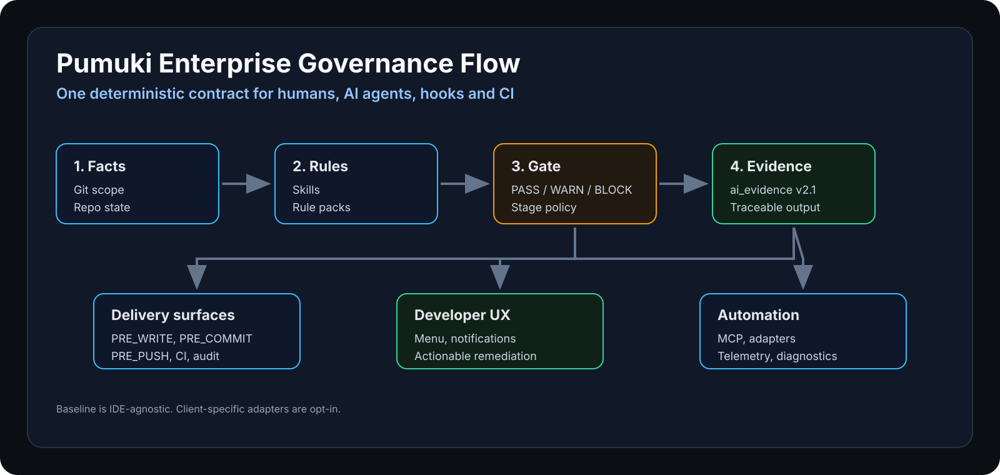
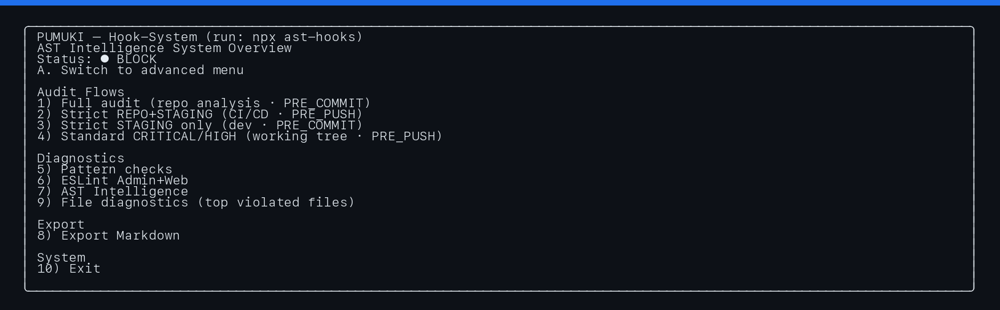
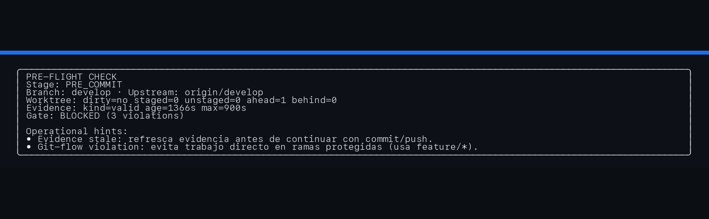
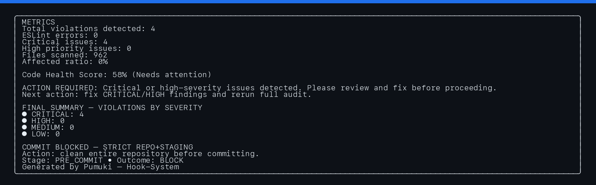

# Pumuki

<p align="center">
  
</p>

<p align="center">
  <a href="https://www.npmjs.com/package/pumuki"></a>
  <a href="https://github.com/SwiftEnProfundidad/ast-intelligence-hooks/actions/workflows/ci.yml"></a>
  
  <a href="LICENSE"></a>
</p>

Pumuki is an enterprise governance framework for AI-assisted software delivery.

It turns repository rules, SDD/OpenSpec workflow, Git hooks, AST intelligence, skills contracts, evidence, notifications, an interactive menu and optional MCP servers into one deterministic delivery contract:

```text
Facts -> Rules -> Gate -> Evidence
```

Pumuki is built for teams that need AI agents and humans to follow the same engineering law: know the active change, evaluate the real diff, block unsafe delivery, explain the reason in developer language, and leave auditable evidence.

Current maturity: **advanced beta**. The framework is already useful for governed internal adoption and consumer-repository rollout, but the project is still evolving quickly.

## Contents

- [Why Pumuki Exists](#why-pumuki-exists)
- [What Pumuki Does](#what-pumuki-does)
- [Architecture](#architecture)
- [Quick Start](#quick-start)
- [Installation](#installation)
- [Uninstallation and Upgrade](#uninstallation-and-upgrade)
- [Command Reference](#command-reference)
- [Git Hooks and CI](#git-hooks-and-ci)
- [SDD and OpenSpec](#sdd-and-openspec)
- [Session Continuity and AI Window Handoff](#session-continuity-and-ai-window-handoff)
- [AST Intelligence and Rule Packs](#ast-intelligence-and-rule-packs)
- [Evidence](#evidence)
- [Menu and Notifications](#menu-and-notifications)
- [MCP and Agent Adapters](#mcp-and-agent-adapters)
- [Enterprise Operations](#enterprise-operations)
- [Adoption Models](#adoption-models)
- [Troubleshooting](#troubleshooting)
- [Documentation](#documentation)
- [Contributing](#contributing)
- [License](#license)

## Why Pumuki Exists

AI-assisted development increases delivery speed, but it also increases the risk of ungoverned changes: skipped tests, missing specs, vague evidence, mixed commits, stale repo context, unsafe hooks, and rules that live only in documentation.

Pumuki makes those rules executable.

It is designed to answer operational questions before a change enters the repository:

| Question | Pumuki answer |
|---|---|
| What is being changed? | Git scope, SDD context and repository facts. |
| Which rules apply? | Platform rule packs, skills contracts, policy-as-code and project overrides. |
| Can this change proceed? | Deterministic gate decision per stage. |
| Why was it blocked? | Developer-facing cause, file, rule and remediation. |
| What evidence remains? | `.ai_evidence.json` v2.1 plus optional MCP/telemetry access. |

Pumuki does not replace product tests, code review, domain acceptance criteria or security review. It enforces the delivery contract around them.

## What Pumuki Does

Pumuki provides a governed delivery surface for modern repositories:

| Capability | What it provides |
|---|---|
| Git lifecycle | Managed `pre-commit` and `pre-push` hooks, with chained `PRE_WRITE` by default. |
| Stage gates | `PRE_WRITE`, `PRE_COMMIT`, `PRE_PUSH` and `CI` policies with deterministic semantics. |
| Full audit | `pumuki audit` for tracked-repository evaluation outside a hook. |
| SDD/OpenSpec | Change sessions, validation, evidence sync and state sync. |
| Session continuity | Repo-owned context, SDD state, evidence and MCP resources so a new AI window can resume from facts instead of chat memory. |
| AST intelligence | Rule-backed findings for iOS, Android, backend, frontend and generic TypeScript patterns. |
| Skills contracts | Compiled rules from enterprise skills, with coverage checks and missing-detector protection. |
| Evidence | Stable `.ai_evidence.json` v2.1 snapshots for auditability and automation. |
| Developer UX | Interactive menu, clear blocking messages, terminal output and system notifications. |
| MCP | Optional evidence and enterprise MCP servers over HTTP or stdio. |
| Adapters | Provider-agnostic adapter scaffolding for Codex, Claude, Cursor, Windsurf and Opencode. |
| Policy-as-code | Optional signed stage-policy contract under `.pumuki/policy-as-code.json`. |
| Telemetry | Optional JSONL and OTLP export for enterprise observability. |
| Brownfield control | Scope-aware gates that avoid blocking a slice for unrelated historical debt. |

## Architecture

<p align="center">
  
</p>

Pumuki keeps product decisions deterministic by separating domain logic from integrations:

| Layer | Responsibility |
|---|---|
| `core/*` | Facts, rules, rule presets and gate decision model. |
| `integrations/*` | Git scopes, stage policies, evidence, SDD, MCP, notifications and lifecycle adapters. |
| `bin/*` | Public CLI binaries published by npm. |
| `docs/*` | Product documentation, operation guides, MCP contracts and rule-pack references. |
| `vendor/skills/*` | Vendored enterprise skill contracts consumed by the rules compiler. |

Core pipeline:

```text
Git scope / repo state
  -> fact extraction
  -> platform detection
  -> rule-pack and skills loading
  -> stage policy evaluation
  -> gate decision
  -> evidence, notification and optional MCP/telemetry output
```

Pumuki is IDE-agnostic at baseline. Git hooks, gates, lifecycle, evidence and policy enforcement do not require Cursor, Codex, Claude or any other IDE. IDE/client files are opt-in adapter output.

## Quick Start

Prerequisites:

- Node.js `>=18`
- npm `>=9`
- Git repository

Install Pumuki in a consumer repository:

```bash
npm install --save-exact pumuki
npx --yes pumuki bootstrap --enterprise
npx --yes pumuki status --json
npx --yes pumuki doctor --deep --json
```

After bootstrap, the normal developer path is intentionally small:

```bash
git add <files>
git commit
git push
```

Managed hooks run the required Pumuki lifecycle automatically. Teams only reach for explicit commands when they need setup, diagnostics, CI wiring, SDD evidence, MCP servers or operational recovery.

Open a governed SDD change session when the repository requires explicit SDD/OpenSpec control:

```bash
npx --yes pumuki sdd status
npx --yes pumuki sdd session --open --change=<change-id>
npx --yes pumuki sdd validate --stage=PRE_COMMIT --json
```

Run a full tracked-repository audit only for diagnostics or governance reporting:

```bash
npx --yes pumuki audit --json
npx --yes pumuki audit --stage=CI --engine --json
```

## Installation

### Consumer Repository

Recommended enterprise path:

```bash
npm install --save-exact pumuki
npx --yes pumuki bootstrap --enterprise
```

What the bootstrap path does:

- installs managed Git hooks;
- configures lifecycle state;
- creates `.pumuki/adapter.json` when missing;
- prepares OpenSpec/SDD baseline where applicable;
- initializes evidence when missing;
- runs deep diagnostics.

The package `postinstall` runs a baseline `pumuki install` in Git repositories unless disabled. That baseline is IDE-agnostic: hooks, lifecycle and `.pumuki/adapter.json` are the default product surface.

Useful postinstall controls:

| Variable | Effect |
|---|---|
| `PUMUKI_SKIP_POSTINSTALL=1` | Disable postinstall bootstrap. |
| `PUMUKI_POSTINSTALL_WITH_MCP=1` | Include MCP wiring during postinstall. |
| `PUMUKI_POSTINSTALL_MCP_AGENT=<agent>` | Select optional adapter/client wiring for postinstall. |
| `PUMUKI_SKIP_CHAINED_PRE_WRITE=1` | Skip chained `PRE_WRITE` inside managed hooks. |

### Framework Repository

For maintainers of this repository:

```bash
git clone https://github.com/SwiftEnProfundidad/ast-intelligence-hooks.git
cd ast-intelligence-hooks
npm ci
npm run -s typecheck
npm run -s test:deterministic
```

## Uninstallation and Upgrade

Plain npm removal only removes the dependency. It does not remove managed lifecycle state.

| Goal | Command |
|---|---|
| Remove managed hooks and purge runtime artifacts | `npx --yes pumuki uninstall --purge-artifacts` |
| Remove lifecycle and dependency from package manifests | `npx --yes pumuki remove` |
| Update to latest package and reapply hooks | `npx --yes pumuki update --latest` |
| Standard npm dependency removal only | `npm uninstall pumuki` |

Recommended upgrade check:

```bash
npm install --save-exact pumuki@latest
npx --yes pumuki status --json
npx --yes pumuki doctor --deep --json
npx --yes pumuki policy reconcile --strict --json
```

If `status` or `doctor` reports version drift, use the `alignmentCommand` printed in the JSON payload.

## Command Reference

The main lifecycle binary is `pumuki`. This section is an operator reference, not the expected daily developer workflow. The intended enterprise path is progressive disclosure:

1. `bootstrap` once per repository.
2. work through normal Git operations.
3. let managed hooks, CI and policy decide automatically.
4. use explicit commands only for diagnostics, evidence, adapters, SDD operations or automation.

```text
pumuki --version | -v
pumuki bootstrap [--enterprise] [--agent=<name>] [--json]
pumuki install [--with-mcp] [--agent=<name>]
pumuki uninstall [--purge-artifacts]
pumuki remove
pumuki update [--latest|--spec=<package-spec>]
pumuki doctor [--remote-checks] [--deep] [--parity] [--json]
pumuki audit [--stage=PRE_WRITE|PRE_COMMIT|PRE_PUSH|CI] [--engine] [--json]
pumuki status [--json] [--remote-checks]
pumuki menu
pumuki watch [--stage=<stage>] [--scope=<scope>] [--once] [--json]
pumuki loop run --objective=<text> [--max-attempts=<n>] [--json]
pumuki adapter install --agent=<name> [--dry-run] [--json]
pumuki analytics hotspots report [--top=<n>] [--since-days=<n>] [--json]
pumuki analytics hotspots diagnose [--json]
pumuki policy reconcile [--strict] [--apply] [--json]
pumuki context init|status|repair [--json]
pumuki sdd status|validate|session|sync-docs|sync|learn|auto-sync|evidence|state-sync
```

Published binaries:

| Binary | Purpose |
|---|---|
| `pumuki` | Main lifecycle CLI. |
| `pumuki-framework`, `pumuki-ast-hooks`, `ast-hooks` | Interactive framework/menu entrypoints. |
| `pumuki-pre-write` | PRE_WRITE gate and SDD policy surface. |
| `pumuki-pre-commit` | PRE_COMMIT hook runner. |
| `pumuki-pre-push` | PRE_PUSH hook runner. |
| `pumuki-ci` | CI gate runner. |
| `pumuki-mcp-evidence` | Evidence MCP HTTP server. |
| `pumuki-mcp-enterprise` | Enterprise MCP HTTP server. |
| `pumuki-mcp-evidence-stdio` | Evidence MCP stdio bridge. |
| `pumuki-mcp-enterprise-stdio` | Enterprise MCP stdio bridge. |

Detailed command documentation:

- [Installation Guide](docs/product/INSTALLATION.md)
- [Usage Guide](docs/product/USAGE.md)
- [API Reference](docs/product/API_REFERENCE.md)
- [Operator Playbook](PUMUKI.md)

## Git Hooks and CI

Pumuki evaluates different scopes per stage:

| Stage | Typical trigger | Scope | Purpose |
|---|---|---|---|
| `PRE_WRITE` | Before hook execution or explicit guard | Active write/session context | Prevent unmanaged agent work and invalid SDD state. |
| `PRE_COMMIT` | `pre-commit` | `git diff --cached` | Protect the atomic commit. |
| `PRE_PUSH` | `pre-push` | `upstream..HEAD` | Protect outgoing branch range. |
| `CI` | CI job | CI base range | Repeat the same governance outside the laptop. |
| `audit` | Manual CLI | Git tracked files | Diagnose the full tracked repository. |

Managed `pre-commit` and `pre-push` hooks run `pumuki-pre-write` first by default, then the stage runner. Use `PUMUKI_SKIP_CHAINED_PRE_WRITE=1` only for explicit operational exceptions.

CI entrypoint:

```bash
npx --yes --package pumuki@latest pumuki-ci
```

When GitHub Actions quota or remote CI is not available, this repository uses local validation as the operational merge bar:

```bash
npm run -s validation:local-merge-bar
```

## SDD and OpenSpec

Pumuki supports a mandatory SDD/OpenSpec delivery workflow for enterprise repositories.

Common commands:

```bash
npx --yes pumuki sdd status --json
npx --yes pumuki sdd session --open --change=<change-id> --json
npx --yes pumuki sdd session --refresh --ttl-minutes=90 --json
npx --yes pumuki sdd validate --stage=PRE_WRITE --json
npx --yes pumuki sdd evidence --scenario-id=<id> --test-command='<command>' --test-status=passed --json
npx --yes pumuki sdd state-sync --scenario-id=<id> --status=done --dry-run --json
```

Stage aliases:

| Alias | Stage |
|---|---|
| `RED` | `PRE_WRITE` |
| `GREEN` | `PRE_COMMIT` |
| `REFACTOR` | `PRE_PUSH` |
| `CLOSE` | `CI` |

OpenSpec is resolved from the checked repository, not from a random global binary on `PATH`. Install or bootstrap Pumuki inside the repository so local and CI behavior match.

## Session Continuity and AI Window Handoff

Pumuki is designed for AI-assisted work where the chat window, IDE session or CLI agent can change before the repository work is finished.

It does not claim to preserve private conversational memory from a vendor window. Instead, it externalizes the operational context that matters into repository-owned, auditable state:

| Context surface | What it preserves |
|---|---|
| `.pumuki/context/context.json` | Local context contract for the repository and the instruction that an AI agent must stop if the context cannot be read or validated. |
| `pumuki context init|status|repair` | Initialize, validate or repair the local context gate before edits, audits, commits or pushes. |
| SDD/OpenSpec session state | Active change id, session validity and stage validation through `pumuki sdd status`, `session` and `validate`. |
| `.ai_evidence.json` v2.1 | Last gate snapshot, findings, platform detection, rule provenance, severity breakdown and operational hints. |
| Managed hooks and receipts | PRE_WRITE/PRE_COMMIT/PRE_PUSH/CI decisions, MCP receipt freshness and evidence age. |
| MCP resources | Provider-agnostic resources such as `context://active`, `sdd://status`, `sdd://active-change`, `gitflow://state` and `evidence://status`. |

This makes a new AI window resumable from facts:

```bash
npx --yes pumuki status --json
npx --yes pumuki context status --json
npx --yes pumuki sdd status --json
npx --yes pumuki doctor --deep --json
```

For MCP-capable clients, the same pattern is available through read-only context resources and evidence endpoints before an agent edits files. The expected agent behavior is conservative: if context, evidence or SDD state is missing or invalid, the agent should downgrade to diagnosis and report a blocker instead of mutating production code.

In practice, Pumuki turns "remember what we were doing" into a repository contract: current branch, lifecycle health, active SDD change, latest evidence, blocking findings, remediation and policy provenance are recoverable without trusting the transient memory of one AI session.

## AST Intelligence and Rule Packs

Pumuki detects active platforms and loads rule packs for the real repository shape:

| Platform | Coverage area |
|---|---|
| iOS | Swift, SwiftUI, Swift Testing, concurrency, architecture and security patterns. |
| Android | Kotlin, Compose, DI, lifecycle, architecture and Android-specific risk patterns. |
| Backend | TypeScript/NestJS, DTO validation, controllers, DI, error handling, persistence and security patterns. |
| Frontend | TypeScript/React/Next.js, JSX accessibility, API routes, UI safety and browser risk patterns. |
| Generic | Cross-platform TypeScript, process, filesystem, dynamic code execution and security signals. |

Current baseline families:

- `iosEnterpriseRuleSet`
- `backendRuleSet`
- `frontendRuleSet`
- `androidRuleSet`
- `astHeuristicsRuleSet`
- compiled skills bundles from `skills.lock.json`

Rule-pack documentation:

- [Rule Packs Overview](docs/rule-packs/README.md)
- [iOS Rule Pack](docs/rule-packs/ios.md)
- [Android Rule Pack](docs/rule-packs/android.md)
- [Backend Rule Pack](docs/rule-packs/backend.md)
- [Frontend Rule Pack](docs/rule-packs/frontend.md)
- [AST Heuristics Rule Pack](docs/rule-packs/heuristics.md)

AST intelligence is not a promise that every guideline can be enforced as code. Pumuki distinguishes runtime-code rules, process rules, positive recommendations and rules that still require study, so the gate does not create false confidence.

## Evidence

Pumuki writes deterministic evidence to `.ai_evidence.json` using the v2.1 contract.

Evidence can include:

- stage and policy metadata;
- gate outcome;
- findings and blocking causes;
- loaded rulesets and content hashes;
- detected platforms;
- skills coverage;
- SDD/OpenSpec state;
- operational hints;
- ledger and snapshot metadata.

Reference:

- [AI Evidence v2.1 Contract](docs/mcp/ai-evidence-v2.1-contract.md)
- [Evidence API](docs/product/API_REFERENCE.md#evidence-api)

## Menu and Notifications

Pumuki includes an interactive menu for local developer operation.

Framework repository:

```bash
npm run framework:menu
PUMUKI_MENU_MODE=advanced npm run framework:menu
```

Consumer repository:

```bash
npx --yes --package pumuki@latest pumuki-framework
```

Screenshots from the consumer menu:

| Consumer menu | Blocked pre-flight | Final summary |
|---|---|---|
|  |  |  |

Notification channels include terminal output, stderr mirrors for relevant blocking events and optional system notifications. Blocking messages are expected to explain:

1. blocking cause;
2. concrete rule or skill;
3. file and line when available;
4. missing condition;
5. direct remediation.

Extended walkthrough:

- [Framework Menu Consumer Walkthrough](docs/operations/framework-menu-consumer-walkthrough.md)

## MCP and Agent Adapters

MCP is optional. Git hooks and gates do not depend on MCP.

Pumuki publishes two MCP server families:

| Server | Purpose |
|---|---|
| `pumuki-mcp-evidence` | Read-only evidence context over HTTP. |
| `pumuki-mcp-enterprise` | Enterprise repository state, resources and safe tools over HTTP. |
| `pumuki-mcp-evidence-stdio` | Evidence resources over MCP stdio. |
| `pumuki-mcp-enterprise-stdio` | Enterprise resources/tools over MCP stdio. |

The enterprise server exposes repository-state resources used for session continuity, including `context://active`, `gitflow://state`, `sdd://status`, `sdd://active-change` and `evidence://status`. The evidence server exposes compact and paginated evidence views so agents can load only the facts they need before acting.

Consumer quick start:

```bash
npx --yes --package pumuki@latest pumuki-mcp-evidence
npx --yes --package pumuki@latest pumuki-mcp-enterprise
npx --yes --package pumuki@latest pumuki-mcp-enterprise-stdio
```

Adapter scaffolding:

```bash
npx --yes pumuki adapter install --agent=repo --dry-run --json
npx --yes pumuki adapter install --agent=<agent> --json
npx --yes pumuki adapter install --agent=cursor --dry-run --json
```

Supported adapter targets include `repo`, `cursor`, `claude`, `codex`, `windsurf` and `opencode`. These are opt-in client adapters; the managed Git hooks, gates, lifecycle, evidence and `.pumuki/adapter.json` baseline remain AI-agent, CLI and IDE agnostic.

References:

- [MCP Servers](docs/mcp/mcp-servers-overview.md)
- [Evidence Context Server](docs/mcp/evidence-context-server.md)
- [Agent Context Consumption](docs/mcp/agent-context-consumption.md)

## Enterprise Operations

Pumuki includes enterprise-oriented controls for teams that need governed rollout across multiple repositories.

| Area | Capability |
|---|---|
| Policy-as-code | `.pumuki/policy-as-code.json` with stage signatures and strict validation. |
| Telemetry | Optional JSONL and OTLP export for gate telemetry. |
| Version drift | `status` and `doctor` expose effective/runtime/lifecycle/package alignment. |
| Adapter health | Deep diagnostics for hook and MCP wiring. |
| Worktree hygiene | Guardrails for pending changes and atomic delivery. |
| Consumer rollout | Package smoke, installed-bin smoke and consumer support tooling. |
| Operations policy | SLO/SLA, severity model, incident response and rollback expectations. |

Operational references:

- [Configuration](docs/product/CONFIGURATION.md)
- [Production Operations Policy](docs/operations/production-operations-policy.md)
- [Validation Runbooks](docs/validation/README.md)
- [Release Notes](docs/operations/RELEASE_NOTES.md)
- [Changelog](CHANGELOG.md)

## Adoption Models

| Context | Recommended path |
|---|---|
| Greenfield repository | Install Pumuki early, enable SDD/OpenSpec, commit through hooks from day one. |
| Brownfield repository | Start with scoped hooks and audits; fix active-slice debt before historical debt. |
| AI-enabled team | Treat `AGENTS.md` and skills as the human contract, and Pumuki as executable enforcement. |
| Multi-platform monorepo | Pin platforms when needed and let rule packs activate by detected scope. |
| Enterprise rollout | Pilot in one consumer, validate `doctor/status/hooks`, then repin controlled repositories. |

Suggested rollout checklist:

1. Install exact package version.
2. Run `pumuki bootstrap --enterprise`.
3. Verify `status` and `doctor`.
4. Open an SDD session for a real change.
5. Run `PRE_WRITE` and `PRE_COMMIT`.
6. Validate menu and notification output.
7. Add CI gate when the local contract is stable.
8. Document local exceptions in the consumer repository.

## Troubleshooting

| Symptom | Likely cause | Action |
|---|---|---|
| `SDD_SESSION_MISSING` | No active SDD session. | Run `pumuki sdd session --open --change=<change-id>`. |
| `SDD_SESSION_INVALID` | Session does not match current change or expired. | Run `pumuki sdd session --refresh --ttl-minutes=90`. |
| `OPENSPEC_MISSING` | Repo-local OpenSpec binary is missing. | Run `pumuki bootstrap --enterprise` or install the required package in the repo. |
| PRE_PUSH blocks due to missing upstream | Branch has no tracking ref. | Run `git push --set-upstream origin <branch>`. |
| Version drift in `doctor` | Package/runtime/lifecycle versions differ. | Use the printed `alignmentCommand`. |
| Hook blocks unrelated brownfield debt | Scope classification may be wrong. | Capture command, staged files and JSON output; open an issue. |
| `.ai_evidence.json` changes during docs-only work | Evidence refresh behavior is active. | Review the diff and stage only when the evidence belongs to the slice. |
| MCP port conflict | Another instance is running. | Use `PUMUKI_ENTERPRISE_MCP_PORT=0` for dynamic port allocation. |

Bug report template:

```text
Repository:
Branch:
Pumuki version:
Command:
Expected result:
Actual result:
Staged files:
Relevant output:
Evidence file present:
```

## Documentation

Start here:

- [Operator Playbook](PUMUKI.md)
- [Documentation Index](docs/README.md)
- [Installation](docs/product/INSTALLATION.md)
- [Usage](docs/product/USAGE.md)
- [Architecture](docs/product/ARCHITECTURE.md)
- [Configuration](docs/product/CONFIGURATION.md)
- [API Reference](docs/product/API_REFERENCE.md)
- [Testing](docs/product/TESTING.md)
- [MCP Servers](docs/mcp/mcp-servers-overview.md)
- [Rule Packs](docs/rule-packs/README.md)
- [Governance Standards](docs/governance/CODE_STANDARDS.md)
- [Contributing](docs/governance/CONTRIBUTING.md)

Optional training hub:

- [Pumuki course in Stack My Architecture](https://stack-my-architecture-hub.vercel.app/pumuki/)

## Contributing

For high-quality contributions:

1. Read [Contributing](docs/governance/CONTRIBUTING.md) and [Code Standards](docs/governance/CODE_STANDARDS.md).
2. Work on a dedicated branch.
3. Keep each change atomic.
4. Add focused regression coverage for behavior changes.
5. Run the relevant local validation commands.
6. Open a PR with problem, approach and evidence.

Maintainer validation commands:

```bash
npm run -s typecheck
npm run -s test:deterministic
npm run -s validation:package-manifest
npm run -s smoke:pumuki-surface
```

For release-grade validation in this repository:

```bash
npm run -s validation:local-merge-bar
npm publish --dry-run --access public
```

Publishing to npm is a separate release operation and may require registry auth/MFA handling.

## Support and Security

- Functional issues: use [GitHub Issues](https://github.com/SwiftEnProfundidad/ast-intelligence-hooks/issues).
- Security-sensitive issues: use GitHub Security Advisories or coordinated private disclosure.
- Enterprise diagnostics: attach command output and evidence excerpts, but never include secrets.

## License

MIT. See [LICENSE](LICENSE).
